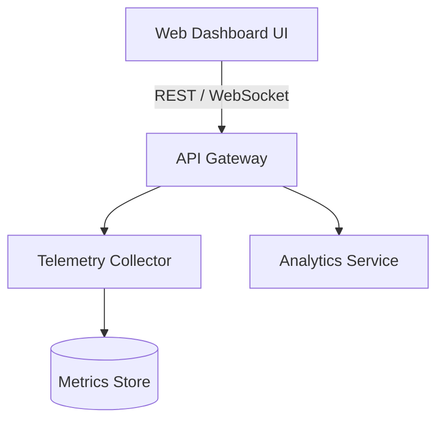

# System Architecture & Design Specification

## Overview
DevAtlas is a modern developer productivity and telemetry dashboard.

## Security & Compliance
- End-to-end TLS 1.3 transport security
- Non-root container runtime isolation
- Automated health probes on `/healthz`
